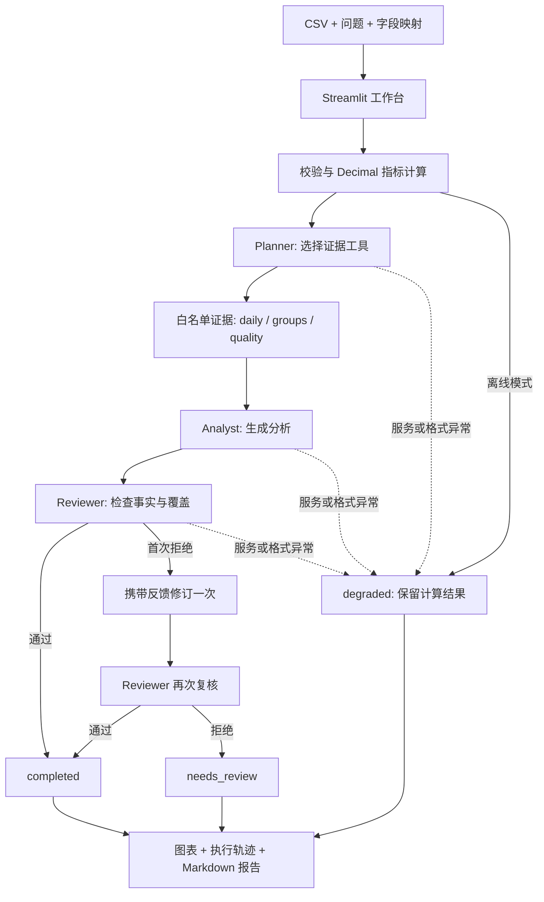

<div align="center">

# Insight Agent

### 面向经营数据分析的多 Agent 工作台

**让数值可追溯，让分析可复核，让失败有状态。**


[快速开始](#快速开始) · [系统架构](#系统架构) · [Agent 分工](#agent-分工) · [测试与复现](#测试与复现) · [项目边界](#项目边界)

</div>

---

Insight Agent 将 CSV 数据、自然语言问题和可审计计算结合起来，完成 **规划 → 指标计算与证据选择 → 分析 → 独立复核 → 有界修订**。适合展示 AI 应用工程中的工具约束、模型协作、错误处理和模块联调。

项目使用 Python / Pandas / Streamlit，自主实现轻量编排，默认接入 DeepSeek。无需 API Key 也能使用离线计算模式。

> 当前是可运行的受限工具多 Agent 原型。模型审核不等于事实保证；没有生产级容量、通用代码执行或业务准确率承诺。

## 为什么做这个项目

把一份表格直接交给模型，容易混淆计算与解释：金额可能算错、结论可能缺少证据、失败可能仍显示完成。本项目用确定性计算提供证据，再让不同角色完成分析与复核，并显式保留未通过和降级状态。

| 能力 | 实现方式 | 作用 |
|---|---|---|
| 精确金额计算 | Decimal，40 位计算精度 | 避免 CSV 提前转浮点造成精度损失 |
| 多 Agent 协作 | 独立 Planner / Analyst / Reviewer 请求 | 分离规划、回答和审查 |
| 受限工具选择 | daily / groups / quality 白名单 | 选择下游证据范围，不执行任意代码 |
| 有界修订 | 最多一次修订、再次复核 | 避免无限循环与不可控调用 |
| 明确失败状态 | completed / needs_review / degraded | 不把模型失败或拒审包装成成功 |
| 可复现报告 | 指标、计划、复核、事件一起导出 | 便于复盘与检查 |
| 无 Key 演示 | 显式离线模式 | 直接体验真实计算和图表 |

## 示例任务

上传含日期、金额和渠道的订单明细，输入：

> 比较渠道净金额并提示数据限制。

```csv
date,amount,category
2026-10-01,100.10,直营
2026-10-02,200.20,电商
2026-10-02,-10.10,电商
```

Python 计算净金额 **290.20**；直营 **100.10**，电商 **190.10**。Planner 选择分组与质量证据，Analyst 生成解释，Reviewer 检查数字、口径及问题覆盖。

负金额保留计入净额；行数不等同于订单数，行均金额也不等同于客单价。

## 系统架构



**实现细节：** 数据校验和完整聚合在 Planner 前完成。Planner 的工具选择决定交给后续模型的证据，不意味着模型重新执行任意 Python 程序。

## Agent 分工

| 角色 | 输入 | 输出 | 约束 |
|---|---|---|---|
| Planner | 原始问题、字段映射、工具定义、口径 | JSON 计划：tools、goal | 至少选择一个允许的工具 |
| Analyst | 原问题、计划、计算证据、可选复核反馈 | 中文分析文本 | 仅依据证据，说明缺失与限制 |
| Reviewer | 原问题、证据、分析文本 | JSON：approved、feedback | 检查数字、业务口径与回答完整性 |
| Orchestrator | 各阶段结果 | 状态、事件、最终输出 | 最多两次分析与两次复核 |

工具：`daily` 提供每日净金额；`groups` 提供所选字段分组净金额；`quality` 提供负金额、重复行和一致性检查。

## 快速开始

已在 Python 3.13 环境验证。

```bash
git clone https://github.com/jack22sdf/insight-agent.git
cd insight-agent
python -m venv .venv
```

Windows PowerShell：

```powershell
.\.venv\Scripts\python -m pip install -r requirements.txt
.\.venv\Scripts\python -m streamlit run app.py --server.address 127.0.0.1
```

macOS / Linux：

```bash
.venv/bin/python -m pip install -r requirements.txt
.venv/bin/python -m streamlit run app.py --server.address 127.0.0.1
```

浏览器打开 `http://127.0.0.1:8501`，勾选“离线计算”，使用内置数据运行。也可以上传 [示例 CSV](examples/sales.csv)。

## 接入 DeepSeek

复制 `.env.example` 为 `.env`，填入自己的 Key，然后重启应用。不要把 `.env` 提交到 GitHub。

```dotenv
DEEPSEEK_API_KEY=your-api-key
LLM_BASE_URL=https://api.deepseek.com
DEEPSEEK_MODEL=deepseek-flash
```

| 配置 | 作用 | 默认 |
|---|---|---|
| DEEPSEEK_API_KEY | 模型凭据，优先读取 | 无 |
| LLM_API_KEY | 备用凭据变量 | 无 |
| LLM_BASE_URL | 兼容 Chat Completions 的服务地址 | https://api.deepseek.com |
| DEEPSEEK_MODEL | 优先模型名称 | deepseek-flash |
| LLM_MODEL | 备用模型名称 | deepseek-flash |
| RAG_ENV_PATH | 复用已有 RAG 项目的环境文件 | 无 |

仅本地 `.env` 可指定 `RAG_ENV_PATH=/absolute/path/to/rag/.env`，仓库不包含个人路径或凭据。在线模式向配置服务发送问题、字段名及汇总证据；当前请求包含 DeepSeek 的 thinking 配置，其他兼容服务可能需要调整网关。

## 输入、口径与异常处理

- CSV：UTF-8，最多 10 MB、100000 行；三个字段必须不同，表头不能重复或为空。
- 日期：解析后统一为 UTC，无效日期拒绝执行。
- 金额：绝对值不超过 1e18，最多八位小数，拒绝 NaN、Infinity 和空值。
- 分组：空白归为“未分类”；重复记录只提示，不自动删除。
- 一致性：每日汇总和分组汇总必须与总金额一致。
- 上下文：汇总证据超过 50000 字符时停止后续模型调用，保留计算结果。
- 网络：连接超时 10 秒、读取超时 45 秒；模型异常输出通用错误，不展示原始服务异常。
- 会话：输入变更清除旧结果，避免混淆不同数据或问题的报告。

## 开发接口

当前提供 Python 函数接口，没有独立 REST 服务。

```python
from orchestration import run_analysis

result = run_analysis(
    frame, "date", "amount", "category",
    "比较渠道净金额并提示数据限制",
    offline=True,
)
print(result["status"])
```

返回 `metrics`、`explanation`、`plan`、`review`、`events`、`status`。无效输入抛出 `ValueError`；模型阶段失败返回 `degraded`，保留数值。

| 状态 | 含义 |
|---|---|
| completed | 模型流程完成，Reviewer 批准；仍需业务判断 |
| needs_review | 修订后仍未通过复核，需人工检查 |
| degraded | 离线、服务错误、响应格式错误或证据超限 |

## 测试与复现

```bash
python -m unittest discover -v
```

当前 **19 项本地自动测试通过**：9 项计算边界、6 项编排故障与修订、4 项界面联调。测试使用离线或注入网关，不产生模型调用费用。

```bash
python smoke_live.py
```

真实服务冒烟测试使用合成数据，会产生 API 调用，结果写入 `live_smoke_result.json`（默认忽略）。最近验证中净金额为 290.20，选择 groups / quality 并完成复核；多次运行也观察到 needs_review，说明模型输出存在波动。

详见 [验证记录](VALIDATION.md)。这不是单 Agent / 多 Agent 准确率对比，也不能据此声称生产性能提升。

## 项目结构

```text
insight-agent/
├── app.py                  # Streamlit 输入、图表和报告
├── engine.py               # 校验、精确计算、报告组装
├── orchestration.py        # 三角色网关、工具约束、状态流转
├── smoke_live.py            # 显式真实服务验证
├── test_engine.py          # 计算边界
├── test_orchestration.py   # 编排故障注入
├── test_app.py             # 界面联调
├── examples/sales.csv      # 合成示例
├── .env.example            # 无凭据配置模板
├── requirements.txt
└── VALIDATION.md           # 测试与迭代记录
```

## 项目边界

已实现：受限工具多 Agent 编排、一次反馈修订、确定性指标、可视化、审计导出与异常降级。

尚未实现：数据库持久化、任务恢复、多租户、代码沙箱、实时事件推送、预测和因果分析、生产部署验证。当前界面在任务完成后展示事件；刷新或重启可能丢失会话结果。

## 路线图

- [x] CSV 解析、字段映射和确定性计算
- [x] Planner / Analyst / Reviewer 与一次修订
- [x] 故障注入和 Streamlit 联调
- [ ] 持久化任务、取消与恢复
- [ ] 单 Agent / 多 Agent 标准任务集对比
- [ ] Token、延迟与调用成本观测
- [ ] 更细粒度的工具参数与查询能力

## 参考与贡献

参考 [MetaGPT](https://github.com/FoundationAgents/MetaGPT) 和 [AutoGen](https://github.com/microsoft/autogen) 的角色协作思路。本项目独立实现，未复制或集成它们的源码。设计不要求依赖大型 Agent 框架。

欢迎提交最小复现、测试用例或改进 PR。报告问题时请使用合成数据并移除 Key、个人路径和业务隐私。修改计算或编排逻辑后请运行全部测试；涉及模型行为时另行记录真实调用条件与结果。

## 部署到服务器

已提供 Docker Compose + Caddy HTTPS 配置，以及在线密码校验、持久化全站任务限额和单进程并发限制。默认公开示例与离线分析，在线运行需要密码；详见 [服务器部署说明](DEPLOY.md)。当前共 24 项本地测试通过。服务器部署与 TLS 尚待实际环境验证。
